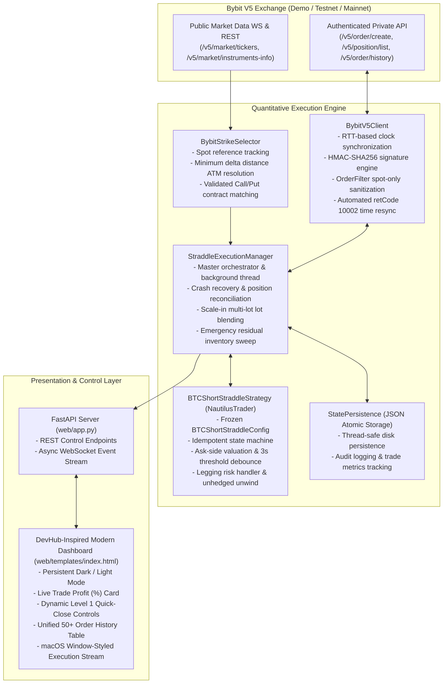

# ⚡ NautilusTrader — BTC Options Short Straddle Execution System

[](https://python.org)
[](https://nautilustrader.io)
[](https://bybit.com)
[](https://fastapi.tiangolo.com)
[](https://pytest.org)
[](LICENSE)

An institutional-grade, low-latency quantitative options trading platform implementing an automated **At-The-Money (ATM) Bitcoin Short Straddle** strategy. Built on top of **NautilusTrader** and integrated with **Bybit V5 Unified Trading Account (Demo / Testnet / Live)**, accompanied by a reactive real-time web dashboard featuring a **DevHub-inspired Dark/Light design system**, sub-second risk automation, live profit tracking, and unified exchange order auditing.

---

## 📑 Table of Contents

- [Executive Summary](#-executive-summary)
- [System Architecture](#-system-architecture)
- [Strategy Implementation](#-strategy-implementation)
  - [Level 1: Naked BTC Short Straddle](#level-1--naked-btc-short-straddle)
  - [Level 2: Automated Risk Management (1% SL / 2% TP)](#level-2--automated-risk-management-1-sl--2-tp)
  - [Scale-In / Multi-Lot Position Averaging](#scale-in--multi-lot-position-averaging)
- [Production Engineering & Exchange Resilience](#-production-engineering--exchange-resilience)
- [DevHub-Inspired Dashboard UI](#-devhub-inspired-dashboard-ui)
- [Quick Start Guide](#-quick-start-guide)
- [Configuration Reference](#-configuration-reference)
- [Verification & Unit Test Suite](#-verification--unit-test-suite)
- [Architectural Q&A (Interview Reference)](#-architectural-qa-interview-reference)
- [Repository & Author](#-repository--author)

---

## 🚀 Executive Summary

A **Short Straddle** is a market-neutral options strategy created by simultaneously selling an At-The-Money Call option and an At-The-Money Put option sharing the exact same strike price and expiry date. 

$$\text{Short Straddle} = \text{Sell 1 ATM Call} + \text{Sell 1 ATM Put}$$

The strategy capitalizes on theta time decay and implied volatility contraction. Because short options carry unlimited theoretical tail risk, this system implements high-frequency ask-side valuation and strict algorithmic exit controls:

- **Entry Premium Baseline**: $V_{\text{entry}} = P_{\text{fill, call}} + P_{\text{fill, put}}$
- **Current Buyback Cost (Ask-side)**: $V_{\text{buyback}} = P_{\text{ask, call}} + P_{\text{ask, put}}$
- **Unrealized Return %**: $\text{PnL } \% = \frac{V_{\text{entry}} - V_{\text{buyback}}}{V_{\text{entry}}} \times 100\%$
- **Unrealized Return $**: $\text{PnL } \$ = (V_{\text{entry}} - V_{\text{buyback}}) \times \text{Position Size}$

---

## 🏛 System Architecture

The project maintains a strict separation of concerns between core NautilusTrader state machines, venue networking, disk persistence, and frontend telemetry.



---

## 📊 Strategy Implementation

### Level 1 — Naked BTC Short Straddle

- **Dynamic Contract Discovery**: Discovers current BTC spot reference price and queries the option chain across available expiries (e.g. daily, weekly, monthly).
- **ATM Resolution**: Selects the strike with minimum absolute distance $|\text{Strike} - S_{\text{ref}}|$, ensuring identical strike and delivery time for both legs.
- **Simultaneous Execution**: Issues simultaneous Sell orders for the Call leg and Put leg via Bybit's `/v5/order/create` endpoint.
- **Live Profit Tracking**: Continuously calculates real-time profit percentage from ask-side buyback quotes.
- **Manual Decision Mode**: Automated SL/TP is disabled. The operator observes live return percentages on the **Current Trade Profit (%)** card and uses the dynamic **`Close & Lock In Profit (+X.XX%)`** button to exit at discretion.

### Level 2 — Automated Risk Management (1% SL / 2% TP)

- **Ask-Side Valuation**: Risk is measured by the actual cost required to close both legs immediately in the open market:
  $$V_{\text{buyback}} = P_{\text{ask, call}} + P_{\text{ask, put}}$$
- **Stop-Loss (+1% Threshold)**:
  $$\text{Exit Triggered if } V_{\text{buyback}} \ge 1.01 \times V_{\text{entry}}$$
  When the buyback premium rises 1% above entry, the strategy automatically fires simultaneous Buy orders (`side: Buy, reduce_only: True`) to prevent runaway losses.
- **Take-Profit (-2% Threshold)**:
  $$\text{Exit Triggered if } V_{\text{buyback}} \le 0.98 \times V_{\text{entry}}$$
  When the buyback premium drops 2% below entry (decaying in the seller's favor), the system buys back both options to lock in realized gains.
- **Debounce Filter**: To prevent premature exits caused by fleeting orderbook spread spikes, threshold breaches must persist for 3 consecutive seconds before triggering exit.
- **Duplicate Exit Guard**: The strategy transitions atomically to `EXIT_TRIGGERED`, preventing double-buybacks or conflicting concurrent exit signals.

### Scale-In / Multi-Lot Position Averaging

Operators can scale into an active straddle by adding position size (e.g. `+0.01 BTC`, `+0.05 BTC`):
1. Submits incremental Sell orders to Bybit for both legs.
2. Recalculates the volume-weighted blended entry premium:
   $$V_{\text{blended}} = \frac{(V_{\text{old}} \times Q_{\text{old}}) + (V_{\text{new}} \times Q_{\text{new}})}{Q_{\text{old}} + Q_{\text{new}}}$$
3. Dynamically recalculates new Stop-Loss ($1.01 \times V_{\text{blended}}$) and Take-Profit ($0.98 \times V_{\text{blended}}$) targets.

---

## 🛡 Production Engineering & Exchange Resilience

During live testing against Bybit's V5 Option environment, key edge cases were identified, diagnosed, and resolved:

| Challenge | Root Cause | Engineering Solution |
| :--- | :--- | :--- |
| **Timestamp Rejections (`retCode: 10002`)** | Bybit strictly rejects orders if request timestamp is $> 1,000\text{ ms}$ ahead of server time. Local machine clock drift caused premature rejections. | Implemented latency-compensated clock sync in `BybitV5Client._sync_time()` measuring network Round-Trip Time (RTT) with a 500ms safety buffer, widened `recv_window` to 20,000ms, and added automatic resync retry. |
| **Invalid Option Parameter (`retCode: 10001`)** | In Bybit V5 `/v5/order/create`, `"orderFilter": "Order"` is only valid for Spot trading; passing it to Options causes immediate rejection. | Sanitized payload construction to omit `orderFilter` for `category: "option"`. |
| **Missing Exchange Orders in UI** | Local audit logs only preserved trades executed in the current session; restarted sessions omitted past orders. | Built unified `/api/orders` endpoint querying Bybit's `/v5/order/history?category=option&baseCoin=BTC` with HMAC-SHA256 query signing, merging live exchange fills with local audit records. |
| **Legging Failure & Asymmetric Fills** | In illiquid markets, one leg may fill while the second remains pending, creating unhedged delta exposure. | If the second leg is unfilled after a configurable timeout (default 10s), the system cancels the pending leg and immediately unwinds the filled leg via market buyback. |
| **Server Crash Recovery** | Unexpected server restart while positions are open leaves options unmonitored. | On startup, `reconcile_positions()` queries `/v5/position/list`, reconstructs the `StraddlePair`, detects entry prices, and seamlessly re-engages the risk monitoring loop. |
| **Emergency Residual Sweep** | Stopping a strategy must guarantee zero leftover short inventory. | On manual operator stop, the engine executes an emergency sweep querying Bybit for any lingering open contracts and submits immediate `reduce_only=True` market buybacks. |

---

## 🎨 DevHub-Inspired Dashboard UI

The user interface takes direct visual inspiration from modern developer workspaces (such as **DevHub**):

```
+---------------------------------------------------------------------------------------------------------+
| >_ BTC Options Straddle   Institutional Engine     [BYBIT DEMO] [API AUTH] [RUNNING] [☀️ Light] [Refresh]|
+---------------------------------------------------------------------------------------------------------+
|                                    @ AI-POWERED QUANTITATIVE STRADDLE                                    |
|               The algorithmic straddle built for traders who ship fast                                  |
+---------------------------------------------------------------------------------------------------------+
| [ BTC Spot: $74,565.00 ] [ Expiry: 11-NOV-26 ] [ Contracts: 164 ] [ Calculated ATM Strike: $74,500 ]   |
| Strike Selector: [ $74,000 ] [ $74,250 ] [ $74,500 (ATM) ] [ $74,750 ] [ $75,000 ]                      |
+---------------------------------------------------------------------------------------------------------+
|  CALL LEG (SELL) - BTC-11NOV26-74500-C-USDT     |   PUT LEG (SELL) - BTC-11NOV26-74500-P-USDT           |
|  Bid: $490.00 (0.05 BTC) | Ask: $495.00 (0.05)  |   Bid: $525.00 (0.05 BTC) | Ask: $530.00 (0.05)       |
+---------------------------------------------------------------------------------------------------------+
| Order Size: [ 0.01 ] BTC    Presets: [ 0.01 ] [ 0.02 ] [ 0.05 ] [ 0.10 ]    Est. Total Premium: $10.25   |
| [ LEVEL 1: NAKED STRADDLE ]                     | [ LEVEL 2: AUTOMATED RISK-MANAGED (1% SL / 2% TP) ]    |
| [ EXECUTE LEVEL 1 (NAKED) ]                     | [ EXECUTE LEVEL 2 (AUTOMATED) ]                       |
+---------------------------------------------------------------------------------------------------------+
|                                  ACTIVE STRATEGY MONITOR (LEVEL 1 / 2)                                  |
| [ Current Trade Profit: +1.28% ] [ PnL ($): +$0.13 ] [ Entry: $1,038.33 ] [ Buyback: $1,025.00 ]        |
| [ Close Positions (Market Buyback) ]                                                                    |
+---------------------------------------------------------------------------------------------------------+
| [ Orders History (70) ]   [ Active Positions (2) ]                                                      |
| 15:39:28 | BTC-11NOV26-74500-P-USDT | SELL | 0.04 BTC | Fill: $1,230.00 | FILLED                       |
| 15:39:28 | BTC-11NOV26-74500-C-USDT | SELL | 0.04 BTC | Fill:   $140.00 | FILLED                       |
+---------------------------------------------------------------------------------------------------------+
| ● ● ● nautilus-node ~ live-telemetry-feed                                              [ Clear Logs ]   |
| 15:39:28 | ORDER | Submitted SELL orders for Call and Put legs (0.04 BTC)                               |
| 15:39:29 | FILL  | Both legs confirmed filled on Bybit Demo. Monitoring active.                         |
+---------------------------------------------------------------------------------------------------------+
```

### Visual Highlights:
- **Persistent Theme Engine**: Toggle effortlessly between **Dark Mode** (deep void `#080C14` with neon mint `#00E599` accents) and **Light Mode** (clean slate `#F8FAFC` with rich emerald `#059669`). Theme preference persists via `localStorage` with zero white flicker (Zero-FOUC).
- **High-Contrast Input Controls**: Order sizing and preset buttons are styled with custom themed surfaces, ensuring crisp legibility under both modes.
- **Consistent Execution CTAs**: Both Level 1 and Level 2 buttons share identical geometry, typography, and glowing hover states.
- **macOS Window Controls on Telemetry**: The log card features macOS-styled window dots (`#FF5F56`, `#FFBD2E`, `#27C93F`) and a monospace execution stream.

---

## ⚡ Quick Start Guide

### 1. Prerequisites
- Python 3.10+ (tested on Python 3.12)
- Bybit Account (Demo Trading or Testnet API credentials)

### 2. Installation
```powershell
# Clone the repository
git clone https://github.com/Amankum25/mernplus-intern-assignment.git
cd mernplus-intern-assignment

# Create and activate virtual environment
python -m venv .venv
.\.venv\Scripts\activate

# Install dependencies
pip install -r requirements.txt
```

### 3. Environment Configuration
Create a `.env` file in the project root:
```ini
BYBIT_API_KEY=your_bybit_api_key_here
BYBIT_API_SECRET=your_bybit_api_secret_here
BYBIT_ENVIRONMENT=DEMO          # Options: DEMO, TESTNET, MAINNET
WEB_PORT=8000
WEB_HOST=127.0.0.1
```

### 4. Running the System

#### All-In-One Master Runner (Recommended)
Runs unit tests, performs live market ATM strike discovery, launches the FastAPI server, and opens your browser:
```powershell
python run.py
# Or on Windows, double-click:
.\run.bat
```

#### Standalone Launch Options
```powershell
# 1. Launch only the Web Dashboard:
python run.py --web

# 2. Run the Unit Test Suite:
python run.py --test

# 3. Run the strategy directly in Terminal CLI mode:
python run.py --cli --level 1 --qty 0.01    # Level 1 Naked
python run.py --cli --level 2 --qty 0.01    # Level 2 Automated Risk
```

The web dashboard is available at: **`http://127.0.0.1:8000`**

---

## ⚙️ Configuration Reference

Strategy parameters are defined in `BTCShortStraddleConfig` ([`straddle/config.py`](straddle/config.py)):

| Parameter | Type | Default | Description |
| :--- | :--- | :--- | :--- |
| `call_instrument_id` | `InstrumentId` | Required | Nautilus instrument identifier for Call leg |
| `put_instrument_id` | `InstrumentId` | Required | Nautilus instrument identifier for Put leg |
| `trade_size` | `Decimal` | `0.01` | Order size in BTC per leg (0.01 is Bybit's minimum) |
| `level` | `int` | `2` | `1` = Naked Straddle, `2` = Automated 1% SL / 2% TP |
| `stop_loss_pct` | `Decimal` | `0.01` | Exit threshold if buyback premium rises 1% (+1%) |
| `take_profit_pct` | `Decimal` | `0.02` | Exit threshold if buyback premium falls 2% (-2%) |
| `entry_timeout_secs` | `float` | `10.0` | Maximum wait time for leg fill before unwinding |
| `simulated_execution` | `bool` | `False` | Emulate fills locally using live quotes (no real orders) |

---

## 🧪 Verification & Unit Test Suite

The test suite validates core quantitative logic, contract discovery, risk threshold triggers, duplicate exit protection, and legging risk management:

```powershell
.\.venv\Scripts\python -m pytest tests/test_straddle.py -v -s
```

### Test Coverage:
1. **`test_atm_strike_calculation_logic`**: Validates nearest ATM strike resolution logic across spot boundaries.
2. **`test_live_bybit_strike_discovery`**: Connects to Bybit, queries live instruments, and validates Call/Put pairing integrity.
3. **`test_straddle_entry_and_targets_calculation`**: Verifies exact mathematical computation of combined entry premium, 1% Stop-Loss target, and 2% Take-Profit target.
4. **`test_duplicate_exit_attempt_guard`**: Confirms that once an exit trigger is processed, subsequent ticks are ignored (idempotent state transition).
5. **`test_legging_failure_unhedged_handling`**: Simulates single-leg fill with second-leg timeout; validates that the pending order is cancelled and the filled leg is unwound immediately.

```
============================= test session starts =============================
tests/test_straddle.py::test_atm_strike_calculation_logic PASSED         [ 20%]
tests/test_straddle.py::test_live_bybit_strike_discovery PASSED          [ 40%]
tests/test_straddle.py::test_straddle_entry_and_targets_calculation PASSED [ 60%]
tests/test_straddle.py::test_duplicate_exit_attempt_guard PASSED         [ 80%]
tests/test_straddle.py::test_legging_failure_unhedged_handling PASSED    [100%]
============================== 5 passed in 2.97s ==============================
```

---

## 💡 Architectural Q&A (Interview Reference)

A quick guide to architectural decisions implemented in this codebase:

1. **Why use Ask prices for valuation instead of Mark or Mid?**  
   Short options positions can only be closed by buying them back. The true economic cost to exit immediately is determined by the **ask price** (the price sellers are asking). Mid or Mark prices hide the bid-ask spread and underestimate risk.
2. **How does the system prevent clock drift rejections?**  
   The client samples server time, subtracts Round-Trip Time (RTT) latency, and applies a 500ms safety buffer so client timestamps are never ahead of Bybit's server.
3. **What is Legging Risk and how is it mitigated?**  
   Options exchanges do not natively support multi-leg atomic fills. When submitting two distinct orders, one leg might fill while the other lingers unfilled. The system monitors fills with a 10-second timer; if the second leg does not fill, the engine cancels it and market-buys the first leg to eliminate unhedged delta exposure.
4. **How are duplicate exit orders prevented?**  
   The state machine uses an atomic flag (`exit_triggered = True`) and transitions immediately to `StrategyState.EXIT_TRIGGERED`. Any concurrent market ticks or user clicks are discarded.
5. **How does startup reconciliation work?**  
   If the trading server crashes, `reconcile_positions()` queries Bybit's `/v5/position/list` endpoint on boot, detects any open BTC option positions, reconstructs the `StraddlePair`, computes the entry baseline, and resumes continuous risk monitoring automatically.

---

## 👤 Repository & Author

- **Author**: Aman Kumar
- **GitHub Repository**: [https://github.com/Amankum25/mernplus-intern-assignment](https://github.com/Amankum25/mernplus-intern-assignment)
- **Framework**: [NautilusTrader](https://nautilustrader.io) | [FastAPI](https://fastapi.tiangolo.com)
- **Exchange Integration**: [Bybit V5 API](https://bybit-exchange.github.io/docs/v5/intro)
