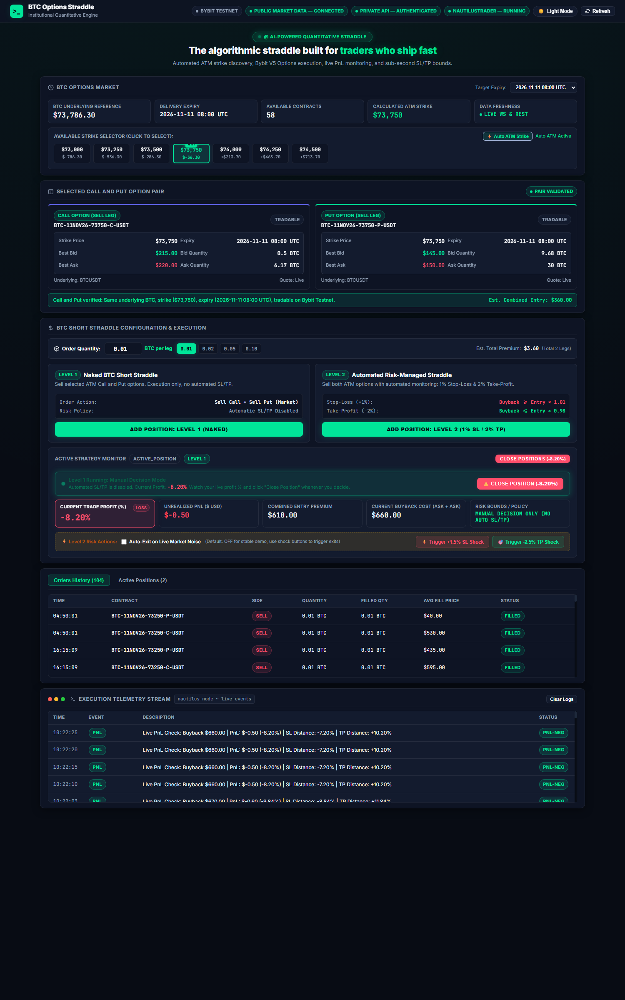
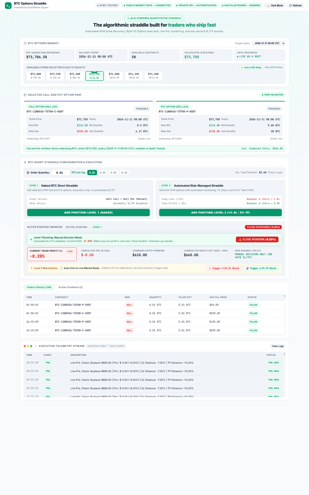
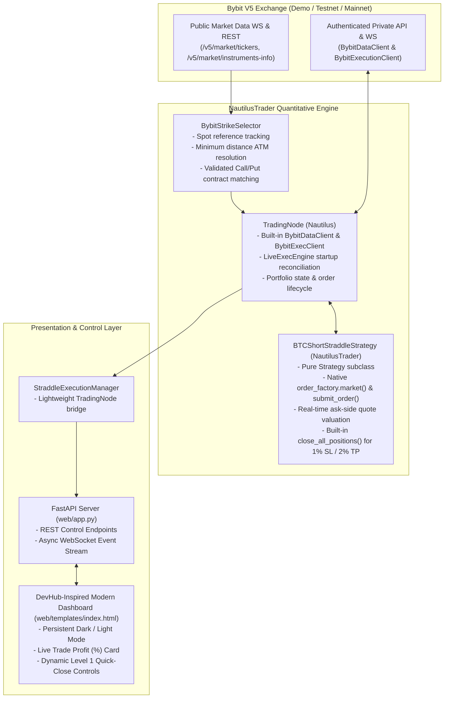

# ⚡ BTC Options Short Straddle Execution System

An institutional-grade, low-latency quantitative options trading platform implementing an automated **At-The-Money (ATM) Bitcoin Short Straddle** strategy. Built on top of **NautilusTrader** and integrated with **Bybit V5 Unified Trading Account (Demo / Testnet / Live)**, accompanied by a reactive real-time web dashboard featuring a **DevHub-inspired Dark/Light design system**, sub-second risk automation, live profit tracking, and unified exchange order auditing.

> **⚠️ Risk Notice:** Options trading involves substantial risk of loss. A short straddle carries theoretically unlimited loss potential. Evaluate this system strictly using Bybit Demo Trading or Testnet. Do not deploy real capital without a comprehensive understanding of options Greeks, exchange margin rules, and volatility tail risks.

<p align="center">
  
  
  
  
  
  
</p>

---

## 📸 Frontend Dashboard Preview

The trading interface features an ultra-responsive, real-time command dashboard engineered with a modern **DevHub-inspired theme system**, supporting instant switching between **Dark Mode (Default)** and **Light Mode**.

### 🌙 DevHub Dark Theme (Default)
> Real-time Bybit V5 Options market feed, automated ATM strike resolution, dual Level 1 & Level 2 execution CTAs, active position PnL telemetry, and unified Bybit exchange order auditing.



<br/>

### ☀️ DevHub Light Theme
> Crisp daytime workspace with high-contrast typography, emerald accents, and persistent Zero-FOUC theme toggling.



---

## 📑 Table of Contents

- [Frontend Dashboard Preview](#-frontend-dashboard-preview)
- [Overview & Strategy Formulation](#-overview--strategy-formulation)
  - [Short Straddle Mechanics](#short-straddle-mechanics)
  - [How PnL is Evaluated](#how-pnl-is-evaluated)
- [System Architecture](#-system-architecture)
  - [Component Responsibilities](#component-responsibilities)
- [Strategy Implementation](#-strategy-implementation)
  - [Level 1: Naked BTC Short Straddle](#level-1--naked-btc-short-straddle)
  - [Level 2: Automated Risk Management (1% SL / 2% TP)](#level-2--automated-risk-management-1-sl--2-tp)
  - [Scale-In & Multi-Lot Position Averaging](#scale-in--multi-lot-position-averaging)
- [Production Engineering & Exchange Resilience](#-production-engineering--exchange-resilience)
- [DevHub-Inspired Dashboard UI](#-devhub-inspired-dashboard-ui)
- [Getting Started](#-getting-started)
  - [Prerequisites](#prerequisites)
  - [Installation](#1-installation)
  - [Environment Configuration](#2-environment-configuration)
  - [Master Launcher & Running Options](#3-running-the-project)
- [Configuration Reference](#-configuration-reference)
- [Verification & Automated Test Suite](#-verification--automated-test-suite)
- [Detailed Engineering Walkthrough](#-detailed-engineering-walkthrough)
- [Technology Stack & Repository Author](#-technology-stack--repository-author)

---

## 🚀 Overview & Strategy Formulation

### Short Straddle Mechanics

A **Short Straddle** is a market-neutral options strategy created by simultaneously selling an At-The-Money Call option and an At-The-Money Put option sharing the exact same strike price and expiry date:

$$\text{Short Straddle} = \text{Sell 1 ATM Call} + \text{Sell 1 ATM Put}$$

The strategy profits from time decay ($\theta$) and implied volatility contraction ($\text{Vega}$), under the expectation that the underlying Bitcoin price will remain within a narrow range around the strike price until expiration.

### How PnL is Evaluated

Let:
- $P_{C,\text{entry}}$: Call premium received at entry
- $P_{P,\text{entry}}$: Put premium received at entry
- $P_{C,\text{ask}}, P_{P,\text{ask}}$: Current ask prices required to buy back each short leg in the open market

The core valuation metrics are computed in real time:

$$\text{Combined Entry Premium: } V_{\text{entry}} = P_{C,\text{entry}} + P_{P,\text{entry}}$$

$$\text{Current Buyback Cost (Ask-Side): } V_{\text{buyback}} = P_{C,\text{ask}} + P_{P,\text{ask}}$$

$$\text{Unrealized Return \%: } \text{Return } \% = \frac{V_{\text{entry}} - V_{\text{buyback}}}{V_{\text{entry}}} \times 100\%$$

$$\text{Unrealized Profit (\$) : } \text{PnL } \$ = (V_{\text{entry}} - V_{\text{buyback}}) \times \text{Position Size}$$

> **Why Ask-side quotes?** Because short positions can only be closed by buying them back, valuation based on the *ask price* reflects the actual economic cost to exit immediately. Mark or mid prices conceal the bid-ask spread and underestimate risk.

---

## 🏛 System Architecture

The project enforces a modular separation of concerns between venue networking, core quantitative state machines, disk persistence, and real-time dashboard telemetry:



### Component Responsibilities

| Component | Path | Responsibility |
| :--- | :--- | :--- |
| `BybitStrikeSelector` | `straddle/strike_selector.py` | Queries live instruments, locates nearest ATM strike to BTC reference, pairs matching Call/Put. |
| `BTCShortStraddleStrategy` | `straddle/strategy.py` | Native NautilusTrader Strategy managing order submission, fill events, ask-side tracking, and Level 2 exits. |
| `BTCShortStraddleConfig` | `straddle/config.py` | Frozen StrategyConfig holding instrument IDs, trade size, and SL/TP percentage thresholds. |
| `TradingNode Runner` | `run_straddle.py` | Official Bybit Live runner configuring `BybitDataClientConfig` & `BybitExecClientConfig` and launching `TradingNode`. |
| `StraddleExecutionManager` | `straddle/execution_manager.py` | Lightweight bridge managing `TradingNode` lifecycle for the web dashboard. |
| `FastAPI Application` | `web/app.py` | REST endpoints for configuration, Level 1 / Level 2 execution, order history, and WebSocket feed. |
| `DevHub Dashboard` | `web/templates/index.html` | Interactive single-page interface with Dark/Light mode, live Greeks, PnL monitoring, and order history. |

---

## 📊 Strategy Implementation

### Level 1 — Naked BTC Short Straddle

- **Dynamic Contract Discovery**: Uses NautilusTrader's native Bybit adapter for the BTC reference price and active option instruments across the nearest delivery expiry.
- **ATM Resolution**: Selects the strike with minimal absolute distance $|\text{Strike} - S_{\text{ref}}|$, ensuring identical strike and expiry for both legs.
- **Paired Market Entry**: Creates both Sell market orders with the NautilusTrader order factory and submits them through the strategy and ExecutionEngine. The native venue adapter handles exchange transport.
- **Manual Decision Mode**: Automated SL/TP is disabled. The operator observes real-time profit percentages and uses the dynamic **`Close & Lock In Profit (+X.XX%)`** button to exit at discretion.

### Level 2 — Automated Risk Management (1% SL / 2% TP)

- **Ask-Side Valuation**: Risk is continuously measured by the live cost required to buy back both short legs immediately:
  $$V_{\text{buyback}} = P_{C,\text{ask}} + P_{P,\text{ask}}$$
- **Stop-Loss (+1% Threshold)**:
  $$\text{Exit Triggered if } V_{\text{buyback}} \ge 1.01 \times V_{\text{entry}}$$
  When the buyback premium rises 1% above entry, the engine fires simultaneous Buy orders (`side: Buy, reduce_only: True`) to prevent runaway losses.
- **Take-Profit (-2% Threshold)**:
  $$\text{Exit Triggered if } V_{\text{buyback}} \le 0.98 \times V_{\text{entry}}$$
  When the buyback cost drops 2% below entry (capturing premium decay), the strategy closes both legs to lock in profit.
- **Duplicate-Exit Protection**: The state machine utilizes an atomic flag (`exit_triggered = True`) and transitions immediately to `StrategyState.EXIT_TRIGGERED`. Any incoming market ticks or concurrent requests are discarded.

### Scale-In & Multi-Lot Position Averaging

When an operator adds subsequent lots while a position is already active, the engine dynamically recalibrates using **volume-weighted average pricing (VWAP)**:

$$V_{\text{entry, blended}} = \frac{V_{\text{old}} \cdot Q_{\text{old}} + V_{\text{new}} \cdot Q_{\text{new}}}{Q_{\text{old}} + Q_{\text{new}}}$$

The 1% SL and 2% TP bounds automatically adapt to the new blended baseline without interrupting the monitoring loop.

---

## 🛡 Production Engineering & Exchange Resilience

| Challenge | Root Cause | Engineering Solution |
| :--- | :--- | :--- |
| **Timestamp or Exchange Validation Rejections** | The exchange can reject orders for venue-specific validation, market, or credential conditions. | Orders and rejection events are handled through NautilusTrader's native Bybit execution adapter; the dashboard displays the adapter's order status and callback details. |
| **Missing Order History After Restart** | In-memory cache history is lost when a process exits. | The application persists actual Nautilus order IDs and fill callbacks; when running, it merges that audit history with orders in NautilusTrader's cache. It does not query Bybit through a separate client. |
| **Legging Failure & Asymmetric Fills** | In illiquid markets, one leg may fill while the second remains pending, creating unhedged delta exposure. | If the second leg is unfilled after a configurable timeout (default 10s), the system cancels the pending leg and immediately unwinds the filled leg via market buyback. |
| **Server Crash Recovery** | The in-memory cache is recreated when a process restarts. | On startup, the app loads the saved entry-to-position mapping and reconciles it against NautilusTrader's live cache. An empty or incomplete cache never clears saved entries or triggers a blind close. |
| **Specific Entry Close** | Bybit nets contracts at the venue, so symbol-only closes can affect multiple entries. | The strategy closes the selected Nautilus virtual positions by their position IDs through the ExecutionEngine. |

---

## 🎨 DevHub-Inspired Dashboard UI

The user interface takes direct visual inspiration from modern developer workspaces (such as **DevHub**):

### Visual Highlights:
- **Persistent Theme Engine**: Toggle effortlessly between **Dark Mode** (deep void `#080C14` with neon mint `#00E599` accents) and **Light Mode** (clean slate `#F8FAFC` with rich emerald `#059669`). Theme preference persists via `localStorage` with zero white flicker (Zero-FOUC) and optional URL query parameter support (`?theme=light`).
- **Interactive Strike Selector**: Visualizes ATM and adjacent strike prices with live distance-to-spot metrics, with automatic ATM strike resolution.
- **High-Contrast Input Controls**: Order sizing and quick-preset buttons (`0.01`, `0.02`, `0.05`, `0.10 BTC`) are styled with custom themed surfaces, ensuring crisp legibility under both modes.
- **Consistent Execution CTAs**: Both Level 1 and Level 2 buttons share identical geometry, typography, and glowing hover states.
- **macOS Window Controls on Telemetry**: The log card features macOS-styled window dots (`#FF5F56`, `#FFBD2E`, `#27C93F`) and a monospace execution stream.
- **Unified Order History**: Displays persisted NautilusTrader order/fill events together with the live Nautilus cache.

---

## ⚡ Getting Started

### Prerequisites
- Python **3.10+** (tested on Python 3.12)
- Bybit Account (Demo Trading or Testnet API credentials)
- Git

### 1. Installation

```powershell
# Clone the repository
git clone https://github.com/Amankum25/mernplus-intern-assignment.git
cd mernplus-intern-assignment

# Create and activate virtual environment
python -m venv .venv
.\.venv\Scripts\Activate.ps1    # On macOS/Linux: source .venv/bin/activate

# Install dependencies
pip install -r requirements.txt
```

### 2. Environment Configuration

Create a `.env` file in the project root (or copy `.env.example`):

```ini
BYBIT_API_KEY=your_bybit_api_key_here
BYBIT_API_SECRET=your_bybit_api_secret_here
BYBIT_ENVIRONMENT=DEMO          # Options: DEMO, TESTNET, MAINNET
DEFAULT_TRADE_QTY=0.01
WEB_PORT=8000
WEB_HOST=127.0.0.1
```

> **Security Note:** Never commit your `.env` file. The repository's `.gitignore` protects credentials from being tracked.

### 3. Running the Project

#### All-In-One Master Runner (Recommended)
Automatically checks dependencies, runs the 5-point unit test suite, queries live Bybit market data for the current ATM strike, launches the FastAPI server, and opens your browser:

```powershell
python run.py
# Or on Windows, double-click:
.\run.bat
```

#### Standalone Launch Options

```powershell
# 1. Launch only the Web Dashboard:
python run.py --web

# 2. Run the Unit Test Suite:
python run.py --test

# 3. Run the strategy directly in Terminal CLI mode:
python run.py --cli --level 1 --qty 0.01    # Level 1 Naked Straddle
python run.py --cli --level 2 --qty 0.01    # Level 2 Automated Risk
```

The web dashboard is available at: **`http://127.0.0.1:8000`**

---

## ⚙️ Configuration Reference

Strategy parameters are defined in `BTCShortStraddleConfig` ([`straddle/config.py`](straddle/config.py)):

| Parameter | Type | Default | Description |
| :--- | :--- | :--- | :--- |
| `call_instrument_id` | `InstrumentId` | Required | Nautilus instrument identifier for Call leg |
| `put_instrument_id` | `InstrumentId` | Required | Nautilus instrument identifier for Put leg |
| `trade_size` | `Decimal` | `0.01` | Order size in BTC per leg (0.01 is Bybit's minimum) |
| `level` | `int` | `2` | `1` = Naked Straddle, `2` = Automated 1% SL / 2% TP |
| `stop_loss_pct` | `Decimal` | `0.01` | Exit threshold if buyback premium rises 1% (+1%) |
| `take_profit_pct` | `Decimal` | `0.02` | Exit threshold if buyback premium falls 2% (-2%) |
| `entry_timeout_secs` | `float` | `10.0` | Maximum wait time for leg fill before unwinding |
| `simulated_execution` | `bool` | `False` | Emulate fills locally using live quotes (no real orders) |

---

## 🧪 Verification & Automated Test Suite

The test suite validates core quantitative logic, contract discovery, risk threshold triggers, duplicate exit protection, and legging risk management:

```powershell
.\.venv\Scripts\python -m pytest tests/test_straddle.py -v -s
```

### Test Coverage:
1. **`test_atm_strike_calculation_logic`**: Validates nearest ATM strike resolution logic across spot boundaries.
2. **`test_live_bybit_strike_discovery`**: Connects to Bybit, queries live instruments, and validates Call/Put pairing integrity.
3. **`test_straddle_entry_and_targets_calculation`**: Verifies exact mathematical computation of combined entry premium, 1% Stop-Loss target, and 2% Take-Profit target.
4. **`test_duplicate_exit_attempt_guard`**: Confirms that once an exit trigger is processed, subsequent ticks are ignored (idempotent state transition).
5. **`test_legging_failure_unhedged_handling`**: Simulates single-leg fill with second-leg timeout; validates that the pending order is cancelled and the filled leg is unwound immediately.

```text
============================= test session starts =============================
platform win32 -- Python 3.12.7, pytest-9.2.0, pluggy-1.7.0
tests/test_straddle.py::test_atm_strike_calculation_logic PASSED         [ 20%]
tests/test_straddle.py::test_live_bybit_strike_discovery PASSED          [ 40%]
tests/test_straddle.py::test_straddle_entry_and_targets_calculation PASSED [ 60%]
tests/test_straddle.py::test_duplicate_exit_attempt_guard PASSED         [ 80%]
tests/test_straddle.py::test_legging_failure_unhedged_handling PASSED    [100%]
============================== 5 passed in 2.71s ==============================
```

---

## 📖 Detailed Engineering Walkthrough

For an in-depth breakdown of the system, execution lifecycles, NautilusTrader integration, Bybit connectivity, order lifecycles, risk management, and interview-oriented technical Q&A, see **[WALKTHROUGH.md](WALKTHROUGH.md)**.

---

## 👤 Technology Stack & Repository Author

- **Author**: Aman Kumar
- **GitHub Repository**: [https://github.com/Amankum25/mernplus-intern-assignment](https://github.com/Amankum25/mernplus-intern-assignment)
- **Framework**: [NautilusTrader](https://nautilustrader.io) | [FastAPI](https://fastapi.tiangolo.com)
- **Exchange Integration**: [Bybit V5 Options API](https://bybit-exchange.github.io/docs/v5/intro)

---

*This repository is provided for engineering demonstration and educational purposes. It is not financial advice and does not guarantee profitability. Trading and execution involve market, liquidity, operational, and technology risks.*
