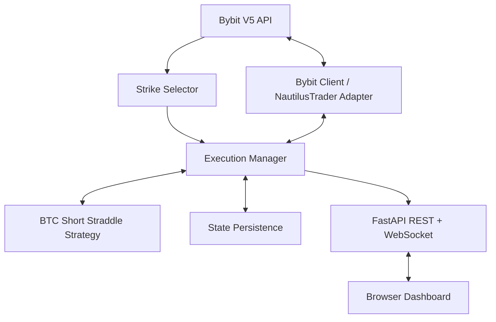

# BTC Options Short Straddle

A Python-based trading system that implements an **ATM BTC options short straddle** on Bybit. It discovers a matching call/put pair, submits and monitors orders through NautilusTrader, and provides a FastAPI dashboard for execution controls, positions, and live strategy updates.

> **Risk notice:** Options trading can result in substantial losses. A naked short straddle has theoretically unlimited loss potential. Use Demo Trading or Testnet while evaluating this project. Do not use real funds without understanding the strategy, exchange rules, margin requirements, and failure modes.

<p align="center">
  
  
  
  
  
</p>

---

## Overview

A **short straddle** sells one call option and one put option with the same underlying asset, strike price, and expiry.

For this project, the system:

1. Reads the BTC reference price and available Bybit option contracts.
2. Selects the nearest available at-the-money (ATM) strike and matching expiry.
3. Submits sell orders for the call and put legs.
4. Tracks order acknowledgements, fills, positions, and the combined premium.
5. In Level 2, monitors the estimated cost of buying both legs back and applies configurable stop-loss and take-profit thresholds.

### Strategy levels

| Mode | Behaviour |
| --- | --- |
| **Level 1 — Manual exit** | Opens the short straddle and displays live trade information. The operator decides when to close. |
| **Level 2 — Managed exit** | Monitors the combined buyback premium and triggers an exit when the configured stop-loss or take-profit condition is met. |

**Default Level 2 thresholds:** stop-loss at a 1% increase in combined buyback premium and take-profit at a 2% decrease. These are strategy thresholds, not guarantees of execution price or maximum loss.

## How PnL is evaluated

Let:

- (P_{C,entry}): call premium received at entry
- (P_{P,entry}): put premium received at entry
- (P_{C,ask}), (P_{P,ask}): current ask prices used to estimate the cost of closing each short leg

Combined entry premium:

[
V_{entry}=P_{C,entry}+P_{P,entry}
]

Estimated combined buyback premium:

[
V_{buyback}=P_{C,ask}+P_{P,ask}
]

Estimated return percentage:

[
Return(%)=rac{V_{entry}-V_{buyback}}{V_{entry}}	imes100
]

Ask-side quotes are used because closing a short option requires buying it back. Actual realized PnL can differ because of fills, fees, slippage, funding or settlement mechanics, and exchange rules.

---

## Features

- **ATM contract discovery** — identifies a call/put pair with a common strike and expiry based on the BTC reference price and available instruments.
- **Bybit V5 integration** — supports configured Demo, Testnet, or Mainnet environments.
- **NautilusTrader execution** — uses the trading engine's strategy lifecycle, order events, and portfolio state.
- **Two execution modes** — manual exits in Level 1 and threshold-based exits in Level 2.
- **Risk controls** — includes duplicate-exit protection and handling for asymmetric or incomplete leg execution.
- **Position recovery and persistence** — stores strategy state and supports reconciliation with exchange positions on restart.
- **FastAPI dashboard** — exposes controls and live status through a browser interface, including a WebSocket event stream.
- **Command-line runner** — supports test, dashboard-only, and CLI execution modes.
- **Automated tests** — covers core selection, premium calculations, exit guards, and legging-failure behaviour.

## Architecture

The project separates exchange communication, strategy logic, orchestration, persistence, and the dashboard.



### Main components

| Component | Responsibility |
| --- | --- |
| `straddle/strike_selector.py` | Finds eligible BTC options and selects a matching ATM call/put pair. |
| `straddle/bybit_client.py` | Handles Bybit V5 API communication and request signing. |
| `straddle/strategy.py` | Implements straddle lifecycle, order handling, valuation, and Level 2 exit checks. |
| `straddle/execution_manager.py` | Coordinates strategy execution, exchange state, recovery, and dashboard-facing operations. |
| `straddle/persistence.py` | Persists strategy and trade-related state. |
| `web/app.py` | Provides the FastAPI application and dashboard API/WebSocket endpoints. |
| `web/templates/` | Contains the dashboard interface. |
| `tests/test_straddle.py` | Contains automated tests for core strategy behaviour. |

---

## Dashboard

The web dashboard provides a central interface to inspect the market and manage the running strategy.

Current interface capabilities include:

- BTC market overview and selected ATM contracts
- Call and put quote information
- Order quantity and execution-mode controls
- Active strategy status and profit/loss estimates
- Position and order history
- Live execution/event logs
- Dark and light display themes

The dashboard is served locally by the FastAPI application. Start it using the instructions below.

---

## Getting started

### Prerequisites

- Python **3.12** recommended
- A Bybit account with API credentials for **Demo Trading** or **Testnet**
- Git

> Start with Demo Trading or Testnet. Keep API keys private and never commit your `.env` file.

### 1. Clone the repository

```bash
git clone https://github.com/Amankum25/mernplus-intern-assignment.git
cd mernplus-intern-assignment
```

### 2. Create a virtual environment

**Windows PowerShell**

```powershell
python -m venv .venv
.\.venv\Scripts\Activate.ps1
```

**macOS / Linux**

```bash
python3 -m venv .venv
source .venv/bin/activate
```

### 3. Install dependencies

```bash
python -m pip install --upgrade pip
pip install -r requirements.txt
```

### 4. Configure environment variables

Create a `.env` file in the repository root. You can use `.env.example` as a starting point.

```env
BYBIT_API_KEY=your_api_key
BYBIT_API_SECRET=your_api_secret
BYBIT_ENVIRONMENT=DEMO

DEFAULT_TRADE_QTY=0.01
WEB_PORT=8000
```

Supported environment values are `DEMO`, `TESTNET`, and `MAINNET`. Use credentials generated for the selected environment. Do not share or commit API credentials.

### 5. Run the project

**Recommended — complete startup**

```bash
python run.py
```

The default runner executes the test suite, attempts a market/contract overview, and starts the dashboard.

Open [http://127.0.0.1:8000](http://127.0.0.1:8000) in your browser.

**Run only the dashboard**

```bash
python run.py --web
```

**Run tests only**

```bash
python run.py --test
```

**Run the strategy in CLI mode**

```bash
# Level 1: manual exit
python run.py --cli --level 1 --qty 0.01

# Level 2: automated threshold monitoring
python run.py --cli --level 2 --qty 0.01
```

Optional runner arguments:

| Argument | Purpose |
| --- | --- |
| `--env DEMO` | Select `DEMO`, `TESTNET`, or `MAINNET`. |
| `--qty 0.01` | Set the order quantity per leg in BTC. |
| `--port 8000` | Set the dashboard port. |
| `--host 127.0.0.1` | Set the dashboard bind host. |
| `--test` | Run only automated tests. |
| `--web` | Start only the dashboard. |
| `--cli` | Start the command-line strategy runner. |

---

## Configuration

Strategy defaults are defined in `straddle/config.py`. Review the configuration in the current code before changing values or running an order.

| Setting | Purpose |
| --- | --- |
| Call and put instrument IDs | Identify the two option contracts used by the strategy. |
| Trade size | BTC quantity submitted for each leg. |
| Strategy level | Selects manual (1) or threshold-managed (2) exit behaviour. |
| Stop-loss percentage | Increase in combined buyback premium that triggers the Level 2 stop. |
| Take-profit percentage | Decrease in combined buyback premium that triggers the Level 2 take-profit. |
| Entry timeout | Maximum configured wait for the two legs to execute as expected. |
| Simulated execution | Enables the configured simulated execution path where supported. |

---

## Tests

Run the test suite with:

```bash
python -m pytest tests/test_straddle.py -v
```

The tests are intended to validate:

- ATM strike selection logic
- Bybit option discovery and call/put pairing
- Entry premium and risk-target calculations
- Protection against duplicate exit attempts
- Handling of a legging failure

Some tests may require exchange connectivity or valid environment configuration. Check the test output and the test implementation to distinguish local unit tests from integration checks.

---

## Repository structure

```text
.
├── straddle/
│   ├── bybit_client.py
│   ├── config.py
│   ├── execution_manager.py
│   ├── persistence.py
│   ├── strategy.py
│   └── strike_selector.py
├── tests/
│   └── test_straddle.py
├── web/
│   ├── app.py
│   └── templates/
├── .env.example
├── requirements.txt
├── run.py
├── run.bat
├── run_dashboard.py
├── run_straddle.py
├── WALKTHROUGH.md
└── README.md
```

---

## Detailed engineering walkthrough

For a deeper explanation of the system, its execution flow, NautilusTrader integration, Bybit connectivity, order lifecycle, risk management, and interview-oriented technical details, see **[WALKTHROUGH.md](WALKTHROUGH.md)**.

## Technology stack

- **Python** — application and strategy implementation
- **NautilusTrader** — event-driven trading and execution framework
- **Bybit V5 API** — options market data and order integration
- **FastAPI** — HTTP API and WebSocket server
- **Uvicorn** — ASGI server
- **Pytest** — automated testing

## Author

**Aman Kumar**  
[GitHub: @Amankum25](https://github.com/Amankum25)

---

*This repository is provided for engineering demonstration and educational purposes. It is not financial advice and does not guarantee profitability. Trading and execution involve market, liquidity, operational, and technology risks.*
