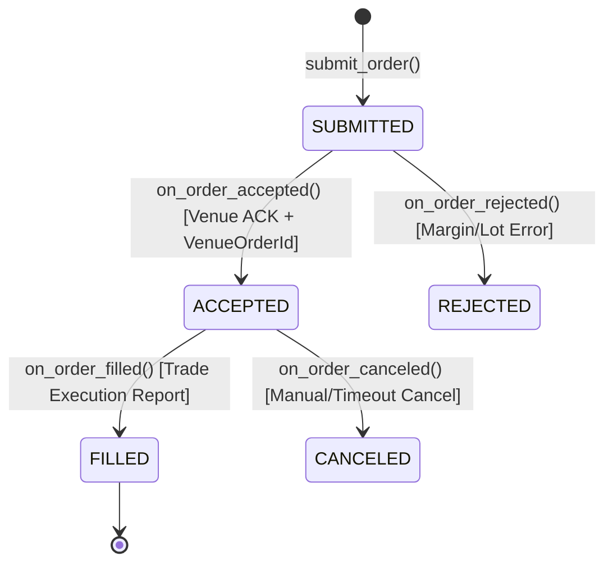

# Engineering Walkthrough: BTC Options Short Straddle Using NautilusTrader

> **Practical Engineering Assignment for the Trading Systems Team**  
> **Framework:** NautilusTrader 1.231.0  
> **Exchange Integration:** Bybit Demo Trading & Testnet (Unified Margin Account / UTA)  
> **Strategy:** BTC At-The-Money (ATM) Short Straddle (Level 1: Naked Straddle; Level 2: Automated 1% Stop-Loss & 2% Take-Profit)  
> **Interface:** FastAPI Interactive Trading Terminal & Real-Time Dashboard  

---

## 1. Executive Summary & Strategy Mechanics

A **Short Straddle** is a non-directional, short-volatility options trading strategy consisting of:
1. **Selling 1 At-The-Money (ATM) Call Option**
2. **Selling 1 At-The-Money (ATM) Put Option**
   - Both options share the **identical strike price** and **identical expiration date**.
   - The ATM strike is dynamically selected based on the live underlying **BTC reference price** and available Bybit strike listings.

```
       Net Profit
           ▲
           │          /▲\ (Peak Profit = Combined Entry Premium)
           │         / │ \
           │        /  │  \
───────────┼───────/───┼───\────────► BTC Price at Expiry
           │      /    │    \
           │     /     │     \
  Max Loss │    /   Strike    \  Max Loss
  Infinite ▼   /    (ATM)      \ Infinite
```

### Strategy Stages Implemented:
- **Level 1 (Naked Straddle)**:
  - Connects to Bybit Demo Trading / Testnet.
  - Queries active option listings and determines the nearest ATM strike based on live BTC price.
  - Submits simultaneous sell orders for both Call and Put legs.
  - Tracks order submission, exchange acknowledgments (ACK), execution fills, and position lifecycle.
  - No automated exit (observes how positions behave as market moves).
- **Level 2 (Automated Risk Management)**:
  - Computes **Combined Entry Premium**:
    $$V_{\text{entry}} = P_{\text{entry, call}} + P_{\text{entry, put}}$$
  - Continuously monitors the live **Combined Buyback Premium** using **ask-side quotes**:
    $$V_{\text{buyback}}(t) = P_{\text{ask, call}}(t) + P_{\text{ask, put}}(t)$$
  - **Stop-Loss (+1%)**: If $V_{\text{buyback}} \ge V_{\text{entry}} \times 1.01$ (+1% increase in buyback cost), automatically triggers market buy orders (`reduce_only=True`) to close both legs.
  - **Take-Profit (-2%)**: If $V_{\text{buyback}} \le V_{\text{entry}} \times 0.98$ (-2% decrease in buyback cost), automatically buys back both legs to lock in profits.
  - **Idempotency & Duplicate Exit Guard**: Prevents concurrent quote ticks from firing duplicate close orders.
  - **Legging Risk Protocol**: Detects partial executions or rejected single legs, cancelling pending orders and immediately unwinding any open naked leg.

---

## 2. Technical Answers to the 10 Interview Walkthrough Questions

### Q1: How does NautilusTrader start and initialize?

**Answer:**  
NautilusTrader is a modular, event-driven algorithmic trading engine written in Python and high-performance Rust/Cython.
Initialization proceeds as follows:
1. **Node Configuration**: A `TradingNodeConfig` specifies the trader ID (`TRADER-001`), database backing, cache configuration, and registered client configurations (`data_clients` and `exec_clients`).
2. **Core Subsystems Assembly**:
   - `MessageBus`: High-throughput asynchronous event bus that connects all publishers and subscribers without polling.
   - `LiveDataEngine`: Manages real-time market data routing, streaming subscriptions, and bar aggregation.
   - `LiveExecEngine`: Coordinates order state machines, execution commands, and venue reconciliation.
   - `LiveRiskEngine`: Performs pre-trade risk and margin verification.
   - `Portfolio`: Maintains real-time cash balances, margin requirements, open positions, and realized/unrealized PnL.
   - `Cache`: In-memory repository caching instrument definitions, order states, and order book snapshots.
3. **Client Factories Registration**:
   `node.add_data_client_factory("BYBIT", BybitLiveDataClientFactory)` and `node.add_exec_client_factory("BYBIT", BybitLiveExecClientFactory)` are registered.
4. **Strategy Registration**:
   The user strategy (`BTCShortStraddleStrategy`) is passed to `node.trader.add_strategy(strategy)`.
5. **Execution Start**:
   Calling `node.run()` starts the `asyncio` event loop, connects WebSocket and REST gateways, loads venue instrument definitions, and fires the strategy's `on_start()` lifecycle hook.

---

### Q2: How have you configured the Bybit integration?

**Answer:**  
The Bybit adapter is configured using NautilusTrader's native Bybit client configurations targeting Bybit's **Demo Trading** environment (`https://api-demo.bybit.com`):
```python
from nautilus_trader.adapters.bybit import (
    BybitDataClientConfig,
    BybitExecClientConfig,
    BybitEnvironment,
    BybitProductType,
)

data_config = BybitDataClientConfig(
    api_key=os.getenv("BYBIT_API_KEY"),
    api_secret=os.getenv("BYBIT_API_SECRET"),
    environment=BybitEnvironment.DEMO,
    product_types=(BybitProductType.OPTION,),
)

exec_config = BybitExecClientConfig(
    api_key=os.getenv("BYBIT_API_KEY"),
    api_secret=os.getenv("BYBIT_API_SECRET"),
    environment=BybitEnvironment.DEMO,
    product_types=(BybitProductType.OPTION,),
)
```
- **Endpoints**:
  - Bybit Demo HTTP: `https://api-demo.bybit.com`
  - Public WebSocket: `wss://stream.bybit.com/v5/public/option` (Bybit routes public market data through the main public stream)
  - Private WebSocket: `wss://stream-demo.bybit.com/v5/private`
  - Trade WebSocket: `wss://stream-demo.bybit.com/v5/trade`
- **Account Mode**: Bybit Unified Trading Account (UTA) utilizing `MARGIN` account mode for derivatives.

---

### Q3: How does NautilusTrader receive market data?

**Answer:**  
1. **Rust-Native WebSocket Client**: Under the hood, `BybitWebSocketClient` in Nautilus's PyO3 Rust extension manages resilient WebSocket connections with automatic heartbeat (ping/pong) and reconnection.
2. **Zero-Copy PyCapsule Delivery**: When a binary or JSON market data frame arrives on the public WebSocket, the Rust client parses it into native data structs and passes it into Python via zero-copy PyCapsules (`capsule_to_data(msg)`).
3. **MessageBus Dispatch**: The `BybitDataClient` converts the capsule into strongly typed domain objects (`QuoteTick`, `TradeTick`, `OptionGreeks`) and publishes them onto the `MessageBus`.
4. **Callback Routing**: The MessageBus dispatches the events directly to subscribed strategy callbacks (`on_quote_tick`, `on_trade_tick`) without any polling or thread contention.

---

### Q4: How are BTC option instruments identified and subscribed to?

**Answer:**  
Instrument discovery is managed programmatically by `BybitStrikeSelector` (`straddle/strike_selector.py`):
1. **Reference Price Discovery**: Uses NautilusTrader's native Bybit adapter to read the BTCUSDT linear ticker or options index price ($S_{\text{ref}}$).
2. **Fetching Active Instruments**: Uses NautilusTrader's native Bybit adapter to load listed BTC options. The project does not create or sign raw Bybit HTTP requests.
3. **Filtering Expiries**: Discards expired contracts and identifies the nearest future expiration timestamp ($T_{\text{nearest}}$).
4. **ATM Strike Selection**: Filters all available strikes for $T_{\text{nearest}}$ and identifies the strike closest to $S_{\text{ref}}$:
   $$K_{\text{ATM}} = \arg\min_K |K - S_{\text{ref}}|$$
5. **Contract Pairing**: Matches the corresponding Call and Put contracts sharing $K_{\text{ATM}}$ and $T_{\text{nearest}}$, formatted into Nautilus `InstrumentId`:
   - Call: `BTC-DDMMMYY-K-C-USDT-OPTION.BYBIT`
   - Put: `BTC-DDMMMYY-K-P-USDT-OPTION.BYBIT`
6. **Subscription**: In `on_start()`, the strategy calls:
   ```python
   self.subscribe_quote_ticks(self.call_instrument.id)
   self.subscribe_quote_ticks(self.put_instrument.id)
   ```

---

### Q5: How does the strategy receive market data events?

**Answer:**  
The strategy implements the `on_quote_tick(self, tick: QuoteTick)` lifecycle method:
```python
def on_quote_tick(self, tick: QuoteTick) -> None:
    if tick.instrument_id == self.call_instrument.id:
        self.current_call_ask = tick.ask_price.as_double()
        self.current_call_bid = tick.bid_price.as_double()
    elif tick.instrument_id == self.put_instrument.id:
        self.current_put_ask = tick.ask_price.as_double()
        self.current_put_bid = tick.bid_price.as_double()

    # Re-value buyback valuation when holding active positions
    if self.strategy_state == StrategyState.ACTIVE_POSITION:
        self.current_buyback_premium = self.current_call_ask + self.current_put_ask
        self._check_risk_management()
```
Whenever Bybit emits a top-of-book change, `on_quote_tick()` receives the event within microseconds, refreshing the ask-side quotes used for live buyback valuation.

---

### Q6: How are orders submitted to Bybit?

**Answer:**  
Orders are constructed using the strategy's `order_factory` and dispatched through the execution engine:
```python
# Create Call Sell Order
call_order: MarketOrder = self.order_factory.market(
    instrument_id=self.call_instrument.id,
    order_side=OrderSide.SELL,
    quantity=order_qty,
    time_in_force=TimeInForce.GTC,
)

# Create Put Sell Order
put_order: MarketOrder = self.order_factory.market(
    instrument_id=self.put_instrument.id,
    order_side=OrderSide.SELL,
    quantity=order_qty,
    time_in_force=TimeInForce.GTC,
)

# Submit to Execution Engine
self.submit_order(call_order)
self.submit_order(put_order)
```
1. `order_factory` generates unique `ClientOrderId`s and validates quantity precision according to the instrument definition (`CryptoOption.size_precision` and `lot_size = 0.01`).
2. Calling `self.submit_order()` publishes a `SubmitOrder` command onto the MessageBus.
3. The `LiveExecEngine` validates pre-trade risk and forwards the command to NautilusTrader's native Bybit execution adapter, which handles the exchange connection. The application does not build or send Bybit REST/WebSocket messages itself.

---

### Q7: How does the system know whether an order was accepted or executed?

**Answer:**  
NautilusTrader uses an asynchronous, deterministic order state machine:

- **`on_order_submitted(event: OrderSubmitted)`**: Fired locally when the order leaves the strategy and enters the gateway queue.
- **`on_order_accepted(event: OrderAccepted)`**: Fired when Bybit acknowledges the order, verifies sufficient margin, and returns Bybit's exchange `venue_order_id`.
- **`on_order_rejected(event: OrderRejected)`**: Fired if Bybit rejects the order (e.g. invalid lot size, post-only cross). Triggers the legging risk handler.
- **`on_order_filled(event: OrderFilled)`**: Fired when an execution match occurs. Contains `event.last_px` (fill price) and `event.last_qty` (fill quantity).

---

### Q8: How are positions tracked?

**Answer:**  
Positions are tracked through NautilusTrader's `Portfolio` subsystem:
1. When `on_order_filled` fires, the engine updates net signed quantity (`signed_qty`), realized PnL, and average open price (`avg_px_open`).
2. The engine emits position lifecycle events:
   - `on_position_opened(event: PositionOpened)`: Triggered on initial fill, establishing a `SHORT` position for the option contract.
   - `on_position_changed(event: PositionChanged)`: Triggered on subsequent fills or partial reductions.
   - `on_position_closed(event: PositionClosed)`: Triggered when position signed quantity returns to zero.
3. The strategy queries its position state at any time via:
   ```python
   pos = self.portfolio.position(self.call_instrument.id)
   is_flat = self.portfolio.is_flat(self.call_instrument.id)
   ```

---

### Q9: How have you implemented Stop-Loss and Take-Profit?

**Answer:**  
Level 2 automated risk management is implemented strictly according to the assignment requirements:
1. **Entry Valuation**:
   When both Call and Put sell orders fill, the strategy records:
   $$V_{\text{entry}} = P_{\text{fill, call}} + P_{\text{fill, put}}$$
2. **Threshold Calculation**:
   - **Stop-Loss Target (+1%)**:
     $$T_{\text{SL}} = V_{\text{entry}} \times (1.0 + 0.01)$$
   - **Take-Profit Target (-2%)**:
     $$T_{\text{TP}} = V_{\text{entry}} \times (1.0 - 0.02)$$
3. **Live Valuation using Ask Quotes**:
   Because closing short option positions requires buying them back at market offer prices, the strategy monitors:
   $$V_{\text{buyback}}(t) = P_{\text{ask, call}}(t) + P_{\text{ask, put}}(t)$$
4. **Trigger Evaluation in `on_quote_tick`**:
   - **Stop-Loss**: If $V_{\text{buyback}} \ge T_{\text{SL}}$, buyback costs have increased by 1%. Trigger immediate buyback.
   - **Take-Profit**: If $V_{\text{buyback}} \le T_{\text{TP}}$, buyback costs have decreased by 2%. Trigger immediate buyback.
5. **Idempotency & Duplicate Exit Protection**:
   ```python
   if self.exit_triggered or self.strategy_state != StrategyState.ACTIVE_POSITION:
       return
   self.exit_triggered = True
   self.strategy_state = StrategyState.EXIT_TRIGGERED
   ```
   - **Why Client-Side Evaluation is Mandatory**: According to NautilusTrader's Bybit Orders Capability matrix, Bybit **does not support venue-side `STOP_MARKET` or `STOP_LIMIT` orders for Option products**. Therefore, risk management cannot be offloaded to exchange conditional orders; it must be monitored actively within the strategy event loop.
   - Setting `self.exit_triggered = True` guarantees that rapid subsequent quote ticks cannot fire duplicate exit orders.
   - Closing orders are submitted with `reduce_only=True` to guarantee positions are flattened and never flipped into unintended long positions.

---

### Q10: What happens when one leg gets executed but the other leg does not?

**Answer:**  
Entering a two-legged strategy via separate leg orders introduces **legging risk** (execution imbalance / unhedged directional exposure).
Our strategy handles this through three defensive safeguards:
1. **Exchange Rejection Handling (`on_order_rejected`)**:
   If Leg A fills but Leg B is rejected by Bybit (e.g. margin exhaustion):
   - The strategy immediately invokes `_handle_legging_failure()`.
   - It identifies that Leg A is open without an offsetting leg, transitions to `StrategyState.UNHEDGED_ALERT`, and immediately submits a closing market buy order for Leg A to eliminate directional delta risk.
2. **Entry Timeout Safety Guard**:
   If Leg A fills but Leg B sits unfilled in the order book beyond `entry_timeout_secs` (e.g. 10s):
   - The strategy sends a `cancel_order` command for Leg B.
   - It submits an emergency closing order for Leg A to return the account to a flat, risk-neutral state.
3. **Partial Fill Balancing**:
   If Leg A fills for 0.02 BTC but Leg B fills for only 0.01 BTC:
   - When triggering an exit, closing orders use `abs(pos.signed_qty)` per contract, ensuring each leg is closed for its exact open quantity without overbuying or overselling.

---

## 3. Quick Start & Execution Guide

### Prerequisites
- Python 3.12 (Windows / Linux / macOS)
- NautilusTrader 1.231.0 installed in `.venv`
- Bybit Demo Trading or Testnet account (optional for simulated live-quote demo)

### Step 1: Clone & Configure Credentials
```bash
# Clone and enter workspace
cd newcompanyproject

# Copy environment template
copy .env.example .env
```
Edit `.env` (optional for live Demo trading keys):
```env
BYBIT_API_KEY=your_bybit_demo_key
BYBIT_API_SECRET=your_bybit_demo_secret
BYBIT_ENVIRONMENT=DEMO
DEFAULT_TRADE_QTY=0.01
WEB_PORT=8000
```

### Step 2: Run the Web Dashboard
```bash
.\.venv\Scripts\python run_dashboard.py --port 8000 --env DEMO
```
Open **`http://localhost:8000`** in any browser.

### Step 3: Run via Standalone CLI
To run Level 1 (Naked Straddle):
```bash
.\.venv\Scripts\python run_straddle.py --level 1 --qty 0.01 --env DEMO
```
To run Level 2 (Automated 1% SL / 2% TP Straddle):
```bash
.\.venv\Scripts\python run_straddle.py --level 2 --qty 0.01 --env DEMO
```

### Step 4: Run the Test Suite
```bash
.\.venv\Scripts\python -m pytest -v tests
```
All unit tests verify:
- ATM strike discovery & Call/Put contract pairing
- Level 1 & Level 2 Stop-Loss (+1%) and Take-Profit (-2%) valuation math
- Duplicate exit protection (idempotency)
- Legging failure and unhedged single-leg safety unwind

